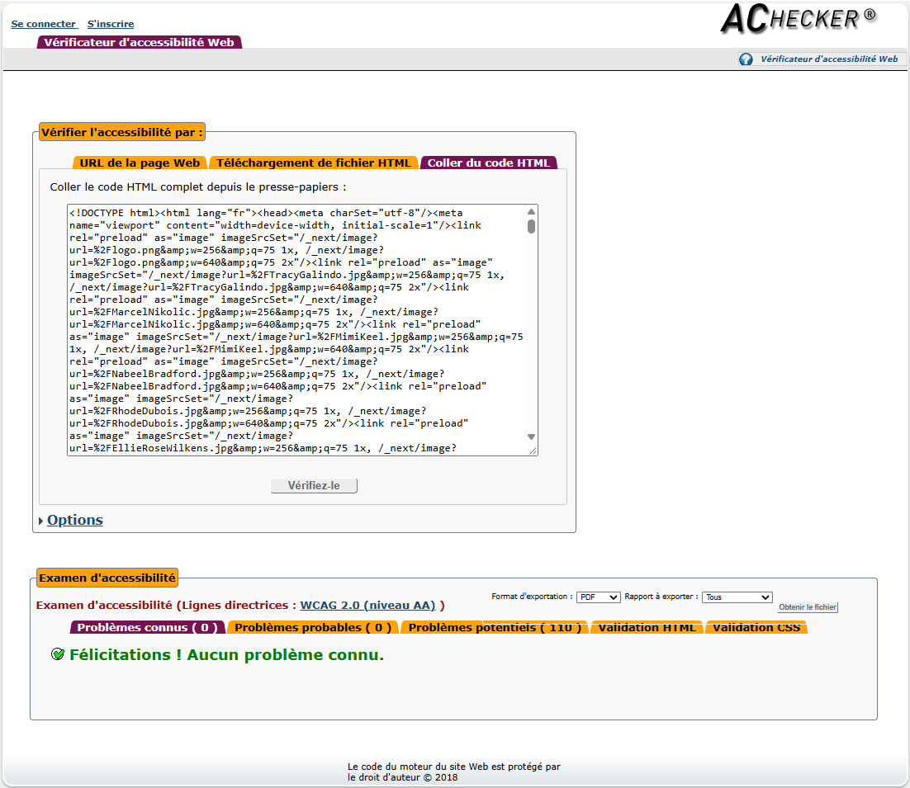
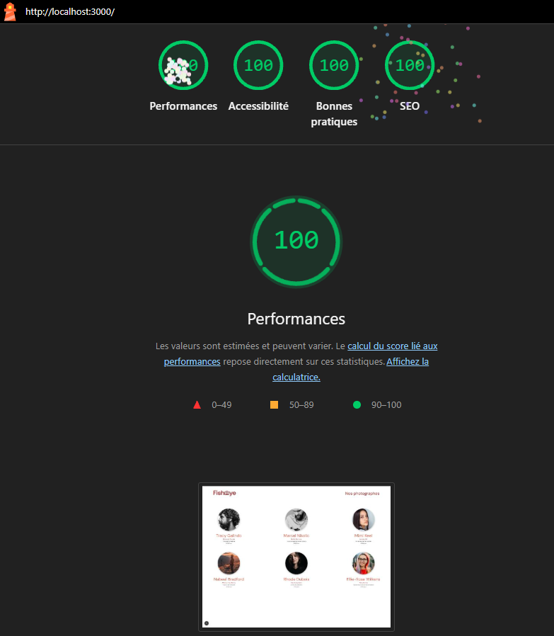
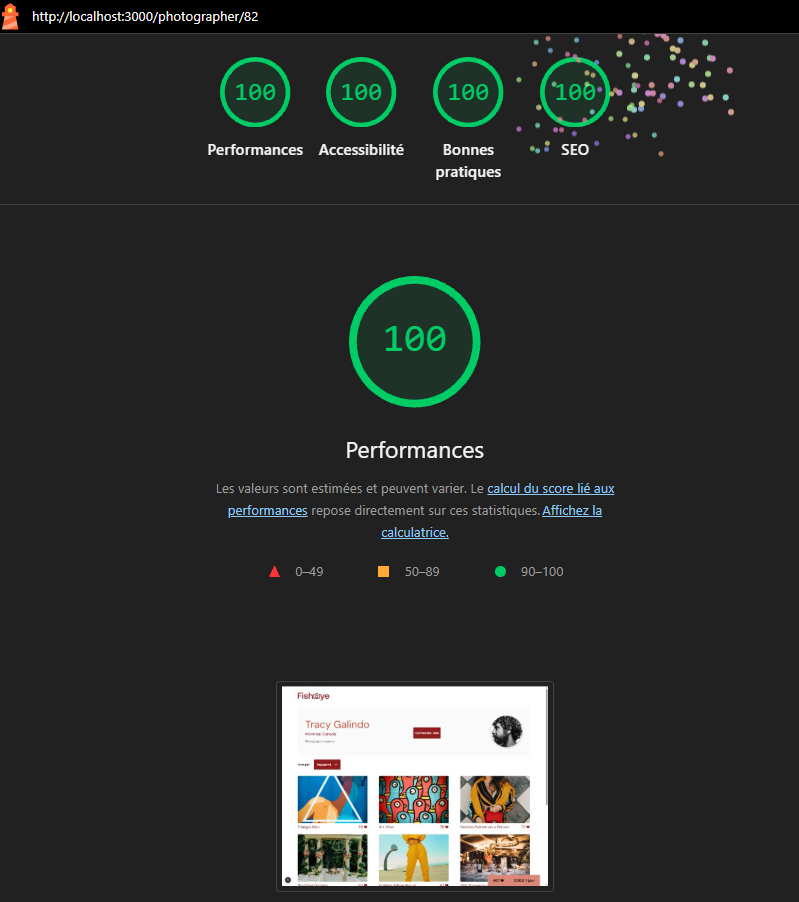

# FishEye – Plateforme de photographes

Prototype Next.js / React accessible (Projet OpenClassrooms).

## Installation

```bash
npm install
npx prisma migrate dev
npx prisma db seed
npm run dev
```

Puis ouvrir http://localhost:3000

## Stack

Next.js 16 (App Router) · React · Prisma 6 · SQLite · ESLint

## Accessibilité

- **AChecker** : aucun problème connu (WCAG)
- **Lighthouse** (bureau) : 100 en accessibilité sur l'accueil et la page photographe




